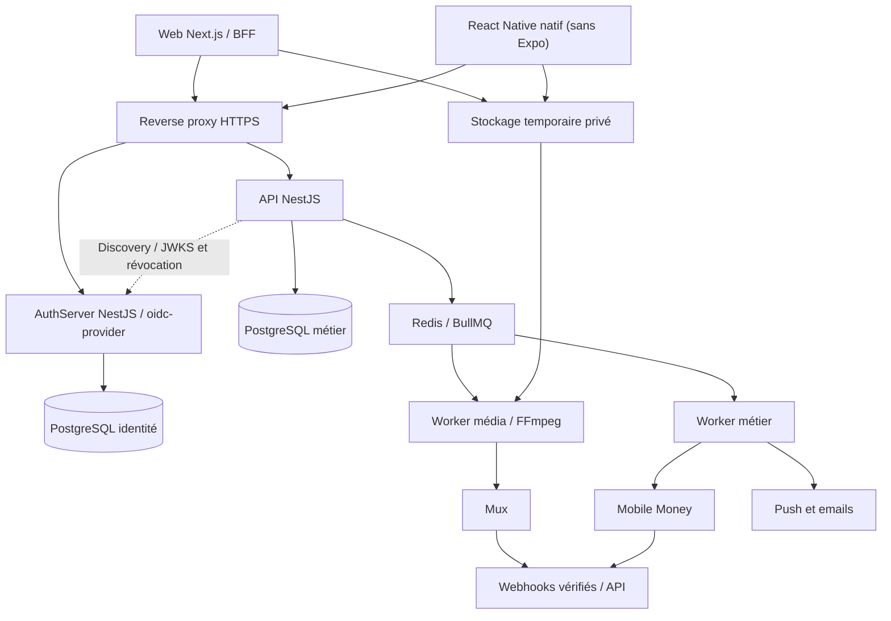

# TALA — Architecture backend cible

Mise à jour : 2 novembre 2026. Statut : architecture cible ; AuthServer et premier lot API/profils implémentés pour vérification locale. Le premier pipeline vidéo est implémenté : voir [le lot vidéo](videos-implementation.md). Les autres modules métier restent à développer. Voir le [guide AuthServer](../authserver/VERIFICATION.md) et le [lot API/profils](api-profils.md).

## 1. Organisation générale

Le backend métier est un **monolithe modulaire NestJS**. Un AuthServer NestJS déployé séparément et un processus de traitement média complètent l'ensemble. Les frontières de processus isolent l'identité et les calculs vidéo ; elles ne créent pas un microservice pour chaque fonction métier. Tous les services applicatifs backend restent en NestJS/TypeScript ; FFmpeg reste l'outil média.

| Composant | Choix cible | Responsabilité |
| --- | --- | --- |
| Web et BFF | Next.js / TypeScript | Interface et session web ; appels serveur vers l'API |
| Mobile | React Native natif (sans Expo) | Android et iOS ; client OIDC public |
| API métier | NestJS / TypeScript | Règles métier, permissions et API REST `/api/v1` |
| Identité TALA | NestJS + `oidc-provider` | Comptes, connexion, MFA et OAuth 2.0/OpenID Connect |
| Données métier | PostgreSQL + Prisma | Transactions métier et migrations appartenant à l'API |
| Données identité | PostgreSQL + Prisma + adapter OIDC | Comptes et persistance protocolaire appartenant à l'AuthServer |
| File de tâches | Redis + BullMQ | Notifications, rapprochement et préparation média |
| Worker métier | NestJS | Tâches asynchrones et intégrations |
| Worker média | Processus isolé + FFmpeg/ffprobe | Analyse et compression contrôlée avant Mux |
| Zone temporaire | Stockage objet privé compatible S3 | Sources et fichiers optimisés avec expiration |
| Vidéo publiée | Mux | Encodage de diffusion, stockage et lecture adaptative |
| Déploiement | Docker / Coolify sur VPS | Services applicatifs et supervision |

**Supabase Auth ne fait plus partie de l'architecture.** PostgreSQL peut être auto-hébergé ou géré, y compris chez un fournisseur indépendant, sans devenir une source d'identité. Auto-héberger toute la suite Supabase n'est pas requis.

Les noms de domaine de production restent à choisir. Prévoir des origines distinctes pour le web, l'API et l'identité ; la politique de cookies/CORS doit être définie sur ces origines exactes.

## 2. Modules métier

| Module | Responsabilité |
| --- | --- |
| Utilisateurs | Profils, langues, préférences et lien vers le `sub` OIDC |
| Permissions | Rôles métier, propriété des ressources et restrictions |
| Vidéos | Imports, états, métadonnées, accès, publication et suppression |
| Fil et découverte | Classement, pagination par curseur et exclusion des contenus interdits |
| Interactions | J'aime, commentaires, favoris, mentions et partage |
| Communauté | Abonnements, blocages et restrictions |
| Recherche | Vidéos, créateurs, hashtags puis sons |
| Abonnements payants | Offres, validité et droits d'accès |
| Paiements | Encaissements, événements, remboursements et rapprochement |
| Revenus créateurs | Calcul, journal comptable, solde disponible et retraits |
| Notifications | Boîte interne, push et emails |
| Modération | Signalements, sanctions, appels et traitement des droits |
| Administration | Gestion opérationnelle et journal d'audit |
| Analytique | Événements de lecture, mesures agrégées et coûts |

Chaque module sépare contrôleurs/contrats, services métier et accès aux données. Les intégrations externes sont derrière des interfaces. La logique financière et les autorisations ne dépendent pas d'une interface cliente.

## 3. Authentification interne NestJS et oidc-provider

### Répartition des responsabilités

Développer notre système signifie gérer nos comptes, nos écrans, nos règles et notre hébergement, en utilisant des implémentations de protocoles et de cryptographie éprouvées.

- **L'AuthServer NestJS** gère les utilisateurs, les mots de passe Argon2id, la vérification email, la récupération, les interactions et la MFA.
- **oidc-provider**, intégré à l'AuthServer, gère le moteur OAuth 2.0/OpenID Connect, les grants, codes, sessions et tokens via un adapter persistant.
- **L'API métier NestJS** est un serveur de ressources : elle accepte les access tokens TALA valides et applique les permissions métier.
- **OAuth 2.0** délègue des accès ; **OIDC** ajoute l'identité et l'ID token. Un ID token n'autorise pas l'appel de l'API.

Le choix précédent de .NET est abandonné à la demande du porteur du projet. OpenIddict reste uniquement une référence conceptuelle historique. Voir [ADR-003](decisions/003-authserver-nestjs-oidc-provider.md) et la [conception détaillée de l'AuthServer](authserver-nestjs.md).

### Clients et parcours

| Client | Parcours | Conservation des secrets |
| --- | --- | --- |
| Web Next.js BFF | Authorization Code + PKCE ; client confidentiel | Tokens côté serveur ; navigateur avec cookie de session HttpOnly/Secure |
| Mobile React Native natif | Authorization Code + PKCE S256 via navigateur système | Aucun secret client embarqué ; refresh token dans le stockage sécurisé OS |
| Administration | Client distinct, Authorization Code + PKCE et MFA | Session serveur et droits restreints |
| Worker technique, si nécessaire | Client Credentials avec scopes limités | Secret ou clé côté serveur ; aucune identité utilisateur implicite |

Prévoir `state`, `nonce`, URI de retour exactes et protection CSRF. Pour le mobile, utiliser des liens de retour enregistrés et vérifiés lorsque disponibles. Ne pas utiliser les flux Implicit ou Resource Owner Password Credentials.

La connexion externe passe par l'identité TALA, avec un client OIDC dédié comme `openid-client` pour les fournisseurs compatibles : après validation auprès du fournisseur, TALA émet ses propres tokens. Associer un fournisseur à un compte existant nécessite une preuve de possession ; pas de fusion automatique sur un email reçu. Le moteur provider n'implémente pas à lui seul la fédération entrante.

### Contrats et validation

Les endpoints d'autorisation, token, userinfo, logout, révocation et introspection sont ceux configurés dans `oidc-provider` et publiés dans la découverte `/.well-known/openid-configuration`. Les chemins `/connect/*` de l'ancienne proposition ne sont plus un contrat acquis. Les clients utilisent les URLs de découverte, dont `jwks_uri`.

- Clients distincts web, mobile et administration ; scopes et audiences explicitement attribués.
- Scopes initiaux possibles : `openid`, `profile`, `email`, `offline_access`, `tala.api`. Ne pas confondre ces scopes avec les permissions métier.
- Pour l'API TALA, configurer explicitement une ressource autorisée et des access tokens JWT **signés asymétriquement**, vérifiables par JWKS. `oidc-provider` peut aussi produire des tokens opaques : le JWT API et son audience ne doivent pas être supposés automatiques. La validation côté API peut utiliser `jose`. Les tokens n'exposent pas de données sensibles.
- Valider signature, algorithmes autorisés, `iss`, `aud`, expiration, type d'access token et scopes. Ne jamais accepter un JWT simplement décodé.
- Garder l'ID token hors du mécanisme d'autorisation API.
- Utiliser des access tokens courts ; cible initiale proposée de 5 à 10 minutes, à confirmer.
- Activer la rotation des refresh tokens et le traitement de leur réutilisation ; tester la révocation de toute la famille/session.
- Un JWT validé localement peut rester accepté jusqu'à son expiration après révocation. Pour les retraits, l'administration et les changements de sécurité, vérifier en plus la session/autorisation active auprès de l'identité et l'état métier courant ; échouer de façon fermée si ce contrôle indispensable est indisponible.
- Prévoir la propagation des suspensions, le cache de clés, la rotation avec chevauchement des clés et les tests de récupération.

### Protection des comptes

Vérification email, récupération à jeton court et à usage unique, anti-énumération, limitation des tentatives, protection contre le credential stuffing, MFA des administrateurs et réauthentification des retraits font partie du périmètre. Les mots de passe ne sont jamais chiffrés de manière réversible ni journalisés. Utiliser Argon2id avec paramètres évalués pour le serveur et réévaluation du hachage à la connexion.

Les clés privées de signature, clés de protection des données sensibles et secrets de signature des cookies doivent être persistants, sauvegardés, protégés et renouvelables. Les JWKS publics ne révèlent jamais les clés privées. Les tokens, cookies, codes et secrets ne figurent pas dans les journaux.

## 4. Propriété des données

Prévoir deux bases logiques ou schémas avec identifiants PostgreSQL distincts :

- Identité : utilisateurs, identités externes, facteurs MFA, sessions, clients OIDC, scopes, autorisations et tokens.
- Métier : profils publics, vidéos, interactions, offres, paiements, écritures, retraits et signalements.

Un même serveur PostgreSQL peut héberger les deux au lancement. L'API utilise le sujet OIDC stable (`sub`) pour référencer l'identité ; elle ne lit ni ne modifie les tables de mots de passe. AuthServer et API possèdent chacun leur schéma Prisma, leurs migrations et leurs identifiants de base. L'adapter OIDC respecte les contrats du provider sans créer un second moteur de tokens.

Les transactions financières utilisent des montants entiers en unité monétaire minimale avec devise explicite, des écritures traçables et des règles de rapprochement. Redis ne constitue jamais le registre des soldes.

## 5. Asynchronisme et cohérence

- API pour les interactions rapides ; workers pour les tâches longues.
- File média séparée des emails et paiements ; concurrence et ressources bornées.
- Tâches et webhooks idempotents, avec identifiants uniques et contraintes en base.
- Nouvelles tentatives bornées, délais progressifs et file d'échecs inspectable.
- Transactional outbox pour publier de façon fiable les tâches résultant d'une modification en base.
- Événements de lecture regroupés et contrôlés avant agrégation ; un appel client ne suffit pas à créer un revenu.
- Confirmation de paiement uniquement après vérification serveur ; le retour de l'écran de paiement n'est pas une preuve.

## 6. Nouveau parcours vidéo

Le parcours précédent « client vers Mux directement » est remplacé par :

1. Autorisation d'import par l'API et réservation du quota.
2. Envoi reprenable vers une zone temporaire privée avec autorisation limitée.
3. Analyse du fichier et choix du profil par le worker média.
4. Compression, normalisation ou conservation du fichier selon la qualité.
5. Vérification du résultat, puis transfert de la source validée à Mux.
6. Réception des webhooks Mux signés et traitement idempotent.
7. Contrôles de publication et de modération.
8. Lecture via Mux après contrôle des droits, avec accès temporaire pour les contenus protégés.

Voir les profils, coûts et conditions de nettoyage dans [pipeline-video.md](pipeline-video.md). Le succès de la compression ne signifie ni que Mux a fini son traitement ni que la vidéo est publiée.

## 7. Déploiement et exploitation

Le VPS peut héberger reverse proxy HTTPS, Next.js, API NestJS, AuthServer NestJS, Redis et workers légers sous Docker/Coolify. AuthServer et API sont des conteneurs, configurations et déploiements indépendants, même s'ils partagent initialement le VPS. La base peut être locale ou gérée. Le stockage temporaire est extérieur ou sur un volume dédié borné, jamais dans le système de fichiers éphémère d'un conteneur.

Le dimensionnement précédent de 4 vCPU/8 Go était une hypothèse pour web/API. **Il ne garantit pas la capacité du nouveau pipeline de transcodage.** Pour une bêta, limiter à une tâche média, protéger les ressources du web et mesurer la file. Recommander un worker média sur un VPS distinct lorsque la charge le justifie ; évaluer 16 Go si tous les composants cohabitent. Aucun nombre d'utilisateurs n'est garanti sans mesure.

Prévoir limites CPU/RAM/disque, rotation des logs, accès réseau privé aux bases et Redis, sauvegardes chiffrées extérieures, restauration testée, alertes et procédure de reprise. Le déploiement applicatif doit pouvoir revenir en arrière sans migrations destructrices automatiques.

## 8. Vérifications avant livraison

- Parcours OIDC web/mobile, PKCE, erreurs de retour, comptes externes, MFA et récupération.
- Rejet des tokens expirés, d'un autre issuer/audience, de mauvais type ou mal signés.
- Rotation des clés, révocation des sessions et réutilisation des refresh tokens.
- Permissions par ressource, accès exclusif et interdiction d'utiliser un ID token comme access token.
- Double webhook, événements désordonnés, double retrait et rapprochement après panne.
- Corpus vidéo varié, qualité après compression et après encodage Mux, annulation et nettoyage.
- Charge du VPS, quotas et restauration des données et clés.

## Sources techniques

- [oidc-provider : moteur OAuth/OIDC Node.js](https://github.com/panva/node-oidc-provider).
- [Documentation et intégration du provider](https://github.com/panva/node-oidc-provider/blob/main/docs/README.md).
- [RFC 9700 : bonnes pratiques de sécurité OAuth 2.0](https://www.rfc-editor.org/rfc/rfc9700.html).
- [Tarification Mux](https://www.mux.com/docs/pricing/overview).
