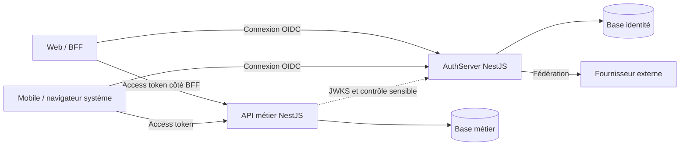

# TALA — AuthServer NestJS indépendant

Date : 28 octobre 2026. Statut : conception de référence et première implémentation dans `authserver/`. Les commandes et endpoints réellement disponibles sont dans le [guide de vérification](../authserver/VERIFICATION.md).

Le [suivi de conformité](authserver-conformite.md) relie les exigences aux modules et aux tests. Une fonctionnalité implémentée ne vaut pas validation de son déploiement ; les exigences ci-dessous restent la référence.

## 1. Choix de référence

Créer `tala-auth`, application NestJS/TypeScript déployée indépendamment de `tala-api`. Employer `oidc-provider` comme moteur OAuth 2.0/OpenID Connect et développer les comptes, écrans, politiques et intégrations dans NestJS.

Cette proposition reprend l'orientation du document fourni par le porteur du projet, en distinguant une architecture des extraits de code encore incomplets. Aucun service .NET ou Supabase Auth n'est retenu.

| Besoin | Choix |
| --- | --- |
| Application | NestJS avec adaptateur HTTP Express et modules TypeScript |
| Protocoles serveur | `oidc-provider`, version maintenue et épinglée après vérification de compatibilité |
| Identités et données | PostgreSQL, Prisma et migrations propres au service |
| Objets protocolaires | Adapter persistant respectant exactement les contrats du provider |
| Mots de passe | Argon2id via bibliothèque maintenue, paramètres mesurés |
| Fédération OIDC | `openid-client` pour les fournisseurs compatibles |
| Vérification JWT par l'API | `jose`, avec politique stricte d'issuer/audience/type/algorithmes |
| Coordination | Redis selon les besoins de rate limiting partagé et de sessions web |
| Déploiement | Conteneur Docker, secrets, domaine et pipeline propres |

La branche v9 est indiquée comme maintenue par le dépôt consulté. La version exacte, les types, les versions Node LTS/NestJS/Prisma et leur compatibilité ESM seront verrouillés à l'initialisation. Ne pas recopier des options d'une version différente sans validation.

## 2. Frontières et responsabilités



AuthServer : comptes, mots de passe, email vérifié, MFA, récupération, clients OAuth, interactions, consentements, sessions et audit d'identité. Le moteur provider possède les grants, authorization codes et tokens ; son adapter en assure la persistance.

API : profils publics, vidéos, abonnements, paiements, revenus et décisions de permission sur les ressources. Un scope API ne donne pas automatiquement le droit d'approuver un paiement ou de modifier une vidéo d'autrui.

Employer un `sub` stable pour relier l'identité au profil. L'API n'accède pas aux tables d'identifiants. Deux bases et comptes PostgreSQL séparés peuvent partager la même instance au départ. Chaque service possède ses migrations. Les créations de profils et suspensions sont propagées de façon idempotente, avec reprise après panne.

## 3. Modules proposés

```text
apps/auth-server/
  prisma/
  src/
    config/             # validation des paramètres et origines
    database/           # Prisma et transactions
    identity/           # comptes et identités externes
    credentials/        # mots de passe et récupération
    mfa/                # facteurs, codes de secours et step-up
    oidc/               # initialisation et configuration du provider
      persistence/      # adapter des objets protocolaires
    interactions/       # login, consentement, MFA et refus
    clients/            # clients OAuth enregistrés et scopes permis
    federation/         # connexions aux fournisseurs externes
    sessions/           # appareils et révocations via le provider
    keys/               # chargement et rotation des clés
    audit/              # événements d'identité sans secrets
    security/           # CSRF, rate limiting et en-têtes
    health/             # disponibilité et état des dépendances
```

Les projets, générés séparément avec Nest CLI, sont `authserver/` et `api/`, avec leurs propres configurations et lockfiles. L'AuthServer organise ces responsabilités en dossiers, modules NestJS et services injectés. Partager les contrats publics, pas les tables d'identité ni les clés privées.

## 4. Premier parcours à rendre fonctionnel

1. Le client prépare une demande Authorization Code avec PKCE S256, `state`, `nonce`, ressource et URI de retour enregistrée.
2. Le provider valide la demande puis déclenche les interactions nécessaires.
3. NestJS vérifie le compte et le mot de passe ; le challenge MFA doit réussir avant de déclarer ce niveau d'authentification atteint.
4. L'interaction de consentement crée/met à jour un grant au moyen du provider, avec les seuls scopes autorisés.
5. Le provider termine l'autorisation et renvoie un code court, lié au client et au PKCE.
6. Le client échange le code et le verifier au token endpoint du provider.
7. L'API accepte uniquement l'access token destiné à sa ressource ; l'ID token reste destiné au client.
8. Le renouvellement, la révocation et le logout passent par les capacités configurées du provider.

Pour le web, privilégier un BFF confidentiel avec tokens côté serveur et cookie HttpOnly/Secure, politique SameSite et CSRF adaptée. Pour le mobile, client public sans secret embarqué, navigateur système et stockage sécurisé OS. Le navigateur reçoit la page de login de l'AuthServer ; il ne transmet pas son mot de passe à l'API métier.

Les appels machine utilisent éventuellement Client Credentials, distinct des sessions utilisateur. Introspection et révocation sont des endpoints de protocole, pas des flux de connexion. Ni le flux Implicit ni Password Grant ne sont retenus.

## 5. Points à préciser dans le document fourni

### Intégration HTTP

Les extraits sont un squelette, pas une configuration prête à copier. Le callback OIDC doit recevoir les routes protocolaires avant un gestionnaire final de 404 et sans qu'un body parser global ait déjà consommé le corps destiné au provider. Prévoir des routes/interactions Nest distinctes, avec parsing et protection adaptés. Un simple montage après `app.init()` ne doit pas être présumé correct : tester Discovery, POST token, interactions et erreurs dans l'ordre réel du middleware Nest/Express retenu.

Le proxy doit préserver l'issuer HTTPS externe ; la confiance dans les en-têtes forwarded est limitée au reverse proxy connu. Ne pas monter les endpoints sous un préfixe arbitraire sans vérifier leurs URLs de découverte.

### Format des tokens

Le provider sait produire des access tokens opaques ou JWT. Pour TALA, configurer la ressource API autorisée et le format JWT signé pour cette ressource, avec audience explicite. Épingler et tester la configuration associée à la version choisie. Ne pas créer un second service `JwtService.sign()` pour les tokens OAuth.

L'API vérifie signature, type d'access token, algorithmes autorisés, issuer, audience, expiration et scopes via une bibliothèque maintenue. L'URL JWKS vient d'un issuer de confiance fixé dans la configuration ; ne jamais découvrir un issuer arbitraire fourni par un token.

### Persistance et concurrence

Les méthodes de l'adapter suivent les types et règles de la version installée. Respecter expiration, `consumed`, recherches par identifiant d'interaction et révocation par grant, avec index par modèle et identifiant. Garder les payloads compatibles avec les modèles du provider et protéger les données sensibles.

Un stockage en mémoire n'est pas la persistance de production. Une méthode `consume()` qui pose simplement une date ne prouve pas à elle seule que deux requêtes concurrentes ne recevront pas des tokens : vérifier le parcours complet du provider et l'adapter sur plusieurs processus. Utiliser les transactions/verrous nécessaires selon les résultats et le contrat de la version, sans inventer un protocole parallèle.

### Identité et MFA

`findAccount` résout les claims du compte, il ne vérifie pas le mot de passe. Le modèle de compte doit effectivement contenir le champ de vérification email utilisé par ce callback. `acr`, `amr` et la date d'authentification reflètent les étapes réellement effectuées ; le succès mot de passe ne termine pas une interaction exigeant MFA.

La fédération entrante demande un module client, validation des réponses et gestion des liens de comptes. Ne pas fusionner automatiquement deux comptes sur la seule égalité de leurs emails.

## 6. Sessions, clés et contrôles sensibles

- Cible initiale : access token de 5 minutes et code de 60 secondes ; durées configurables, validées par tests.
- Refresh tokens soumis à durée absolue/inactivité, rotation et détection de réutilisation selon la politique retenue ; gérer les renouvellements parallèles légitimes sans créer une fausse révocation.
- Clés asymétriques privées et secrets de cookie persistants, propres à chaque environnement et hors Git ; rotation avec chevauchement des clés de vérification.
- Clients connus avec URI de retour exactes ; inscription dynamique de clients désactivée au lancement.
- API d'administration du serveur d'identité protégée par client, audience et permissions explicites ; pas de libre-service public des scopes ou clients.
- JWT validé localement : révocation non immédiate par défaut. Les retraits et changements sensibles exigent un contrôle de session/autorisation actif, plus l'autorisation métier et une réauthentification si nécessaire.
- Un ACR élevé dans un ancien token ne prouve pas une authentification récente : vérifier l'âge et les preuves réellement transmises/validées pour le step-up.
- Rate limiting partagé, CSRF, anti-énumération, récupération à usage unique, MFA administrateur et audit des changements d'accès.
- Le logout AuthServer ne supprime pas automatiquement toutes les sessions BFF et tous les JWT ; définir et tester les effets par client et appareil.

## 7. Réalisation en lots vérifiables

| Lot | Livrable | Critère de validation |
| --- | --- | --- |
| 1 | Projet NestJS, clés persistantes, adapter PostgreSQL et client de test | Discovery/JWKS cohérents et comptes persistants après redémarrage |
| 2 | Login/consentement, Authorization Code + PKCE et API protégée | Parcours complet ; rejet des URI/PKCE/audiences incorrects et codes rejoués |
| 3 | Refresh, révocation et logout | Renouvellement, réutilisation et concurrence testés sur plusieurs instances |
| 4 | Inscription, email, récupération et MFA | Échec des preuves expirées/réutilisées, aucun contournement du second facteur |
| 5 | Fédération, administration des clients et audit | Isolation des clients et association de comptes vérifiées |
| 6 | Déploiement indépendant, sauvegardes et rotation | Reprise testée sans perdre clés ou sessions ; tests de conformité adaptés |

Construire les vérifications de persistance et de protocole dès les premiers lots. La certification annoncée par la bibliothèque ne certifie pas automatiquement la configuration et les interactions TALA.

## 8. Déploiement séparé

AuthServer et API ont leurs images Docker, variables, comptes PostgreSQL, migrations, health checks et pipelines de déploiement. Ils peuvent partager un VPS au lancement, puis être déplacés indépendamment. Le nom d'hôte de l'AuthServer et son issuer doivent rester stables lors d'un déplacement. Le domaine exact reste à choisir.

## Références

- [Dépôt officiel oidc-provider](https://github.com/panva/node-oidc-provider).
- [Documentation officielle, dont intégration Nest et adapter](https://github.com/panva/node-oidc-provider/blob/main/docs/README.md).
- [RFC 9700](https://www.rfc-editor.org/rfc/rfc9700.html).
- [ADR-003](decisions/003-authserver-nestjs-oidc-provider.md).
