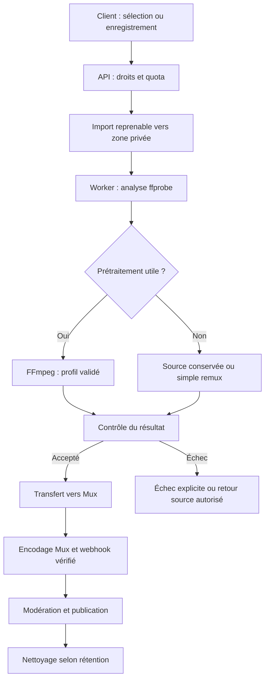

# TALA — Compression et publication vidéo avant Mux

Mise à jour : 3 novembre 2026. Statut : conception de référence ; premier pipeline implémenté avec FFmpeg, stockage privé local, file PostgreSQL de développement, chemin BullMQ et connecteur Mux. Voir [l’implémentation et ses limites](videos-implementation.md).

## 1. Objectif et limite économique

La demande est de réduire le poids des vidéos avant l'envoi à Mux en préservant leur qualité visible. La cible est une **qualité perceptuelle élevée**, pas une garantie de compression sans perte. Une recompression avec perte peut dégrader l'image ; elle doit être mesurée et évitée lorsqu'elle n'apporte pas de bénéfice.

Mux facture principalement à la durée, avec des facteurs de résolution et de qualité. **Réduire les octets d'un fichier sans changer sa durée ni sa classe de résolution ne garantit pas de réduire le stockage facturé par Mux.** Mux réencode aussi les sources pour la diffusion. Cette étape doit donc être validée par son coût total, pas par le seul taux de compression.

Les gains attendus sont la réduction du poids de la source conservée temporairement, des transferts suivants et la maîtrise de la résolution maximale selon les offres. Réduire un profil 4K à 1080p peut modifier le coût Mux mais réduit aussi la résolution : ce compromis doit être annoncé et validé. Une compression sur le serveur ne réduit pas les données déjà dépensées par le créateur pour envoyer le fichier original.

## 2. Parcours de référence

L'API retourne rapidement un identifiant d'import. Elle ne transcode pas dans une requête HTTP. La zone de transit ne possède aucune URL publique permanente. Mux peut récupérer la source à l'aide d'une URL signée temporaire autorisée, ou le worker peut utiliser un mécanisme de transfert pris en charge par le fournisseur. Prévoir la durée de disponibilité nécessaire à sa récupération et aux reprises.

## 3. Analyse avant transformation

Le worker vérifie la signature réelle du format, les pistes, le codec, les dimensions, la rotation, la durée, la cadence, le débit et l'espace couleur. Il contrôle les limites par utilisateur et détecte les sources illisibles ou tronquées.

Il conserve comme métadonnées : taille source, empreinte, résolution et durée, taille de sortie, profil/version, temps CPU, durée de traitement, résultat des contrôles et identifiants Mux. Un nom de fichier utilisateur ne devient jamais une commande ou un chemin système fiable.

## 4. Profils proposés, à valider sur corpus

| Profil | Proposition | Compromis |
| --- | --- | --- |
| Standard | MP4 H.264/AVC + AAC, plafonnement dans une boîte 1920×1080 ou 1080×1920 selon l'orientation | Compatibilité et maîtrise des fichiers surdimensionnés |
| Économie | Plafonnement dans une boîte 1280×720 ou 720×1280, audio adapté à la source | Moins de données, résolution réduite explicitement |
| Haute qualité | Conservation de la résolution autorisée et compression moins agressive | Plus de transfert et coût à mesurer |
| Source déjà optimisée | Conservation ou remux sans réencodage si approprié | Évite une génération de perte inutile |

Pour le profil SDR Standard, un CRF H.264 initial entre 18 et 23 et un preset `medium` constituent des points de test, pas une règle garantissant un résultat. Les paramètres dépendent de la source, du mouvement, du bruit et des capacités du worker.

Règles communes :

- Ne pas agrandir une petite source ; préserver les proportions et la rotation.
- Pas de recadrage implicite, de changement de durée ou de suppression de piste utile sans décision explicite.
- Préserver la cadence lorsque possible ; une réduction de 60 à 30 images/s est un compromis à décider, pas une conservation intégrale de qualité.
- Éviter les conversions répétées des sources déjà compressées.
- Garder un traitement distinct pour HDR/10 bits : préserver avec une chaîne compatible ou effectuer un tone mapping validé. Ne pas convertir aveuglément en SDR 8 bits.
- Préserver la synchronisation audio/vidéo et éviter de réencoder l'audio si la copie est compatible et appropriée.
- Le mode sans perte ne garantit pas un fichier plus petit et ne constitue pas le profil par défaut.
- Évaluer HEVC/AV1 plus tard sur la compatibilité, le temps CPU et le coût ; ne pas supposer qu'un codec plus récent réduit automatiquement la facture Mux.

Les profils exacts sont versionnés et associés à chaque import. Le lancement nécessite des essais sur des shorts verticaux, vidéos longues horizontales, scènes rapides, textes fins, faible lumière et sources déjà compressées.

## 5. Contrôle qualité et choix du fichier

Après traitement, vérifier lecture/décodage, durée, pistes, synchronisation, proportions et absence d'erreur. Comparer poids, qualité visuelle et temps de calcul. Utiliser SSIM et/ou VMAF si disponibles dans la distribution FFmpeg retenue, avec alignement correct des sources ; ces mesures complètent l'inspection visuelle et ne prouvent pas à elles seules l'absence de dégradation.

Les seuils d'acceptation restent à définir sur le corpus et par profil. Si un fichier n'est pas significativement réduit, si le contrôle échoue ou si la source ne supporte pas le profil, conserver la source validée lorsque la politique l'autorise, ou demander une nouvelle version. Ne pas publier silencieusement un résultat dégradé. Tester aussi le résultat final diffusé par Mux pour mesurer la double compression.

## 6. Fiabilité, isolation et cycle de vie

- Identifiant d'import et version de profil pour dédupliquer les tâches.
- Un seul transfert/asset actif par tentative logique ; rapprochement après timeout avant création d'un nouvel asset Mux.
- Machine d'états persistante : `draft`, `uploading`, `analyzing`, `optimizing`, `transferring`, `mux_processing`, `review`, `ready`, `published`, `failed`, `rejected`, `deleted`.
- Webhooks signés, vérifiés et idempotents ; événements anciens sans régression d'état.
- Annulation et suppression propagées aux tâches, fichiers temporaires et assets Mux ; ignorer les callbacks tardifs des imports supprimés.
- Nouvelles tentatives bornées et erreurs visibles au créateur.
- FFmpeg/ffprobe en conteneur non privilégié, avec limites CPU, mémoire, durée, disque et nombre de processus.
- Entrées locales vérifiées, protocoles et accès réseau bornés ; ne pas laisser un média importé provoquer des accès arbitraires à Internet ou au réseau interne.
- Liste d'arguments structurée, sans interpolation shell de données utilisateur.
- Mise à jour des dépendances média et quota de stockage avant démarrage d'une tâche.
- Rétention temporaire proposée de 24 à 72 heures après confirmation de récupération/traitement, à valider ; TTL et nettoyage de secours pour les échecs et imports abandonnés.
- Conserver la source pendant les reprises prévues ; ne pas la supprimer immédiatement après création d'un asset Mux.
- Les URLs signées, clés et contenus privés ne sont pas journalisés.

## 7. Compression sur le téléphone ou le navigateur

Une préparation locale peut être ajoutée pour réduire l'envoi initial : réglage de résolution à l'enregistrement et encodeurs natifs adaptés. Elle devra être évaluée sur des téléphones modestes, avec progression, batterie, chauffe et reprise.

Elle reste une optimisation non fiable du point de vue du serveur : l'analyse et les contrôles de quota restent obligatoires. FFmpeg dans le navigateur n'est pas imposé, notamment à cause de la mémoire et du temps de calcul. La première version repose sur un worker serveur dont le comportement est contrôlable.

## 8. Mesures et coût total

Comparer pour chaque profil :

- Ratio de poids source/sortie et taux de tâches sans gain.
- Temps de calcul et attente en file, consommation CPU/RAM et disque temporaire.
- Qualité avant/après, puis qualité du flux réellement servi par Mux.
- Coût du worker, du stockage temporaire et des transferts.
- Minutes et classe de résolution stockées/diffusées chez Mux.
- Délai entre début d'import et disponibilité de la publication.

Ne retenir un profil économique que si le gain mesuré justifie son temps de calcul, son coût et son compromis de qualité. Aucun pourcentage de compression ou d'économie n'est promis avant ces essais.

## Sources

- [Mux : tarification et unités facturées](https://www.mux.com/docs/pricing/overview).
- [FFmpeg : codecs et options d'encodage](https://ffmpeg.org/ffmpeg-codecs.html).
